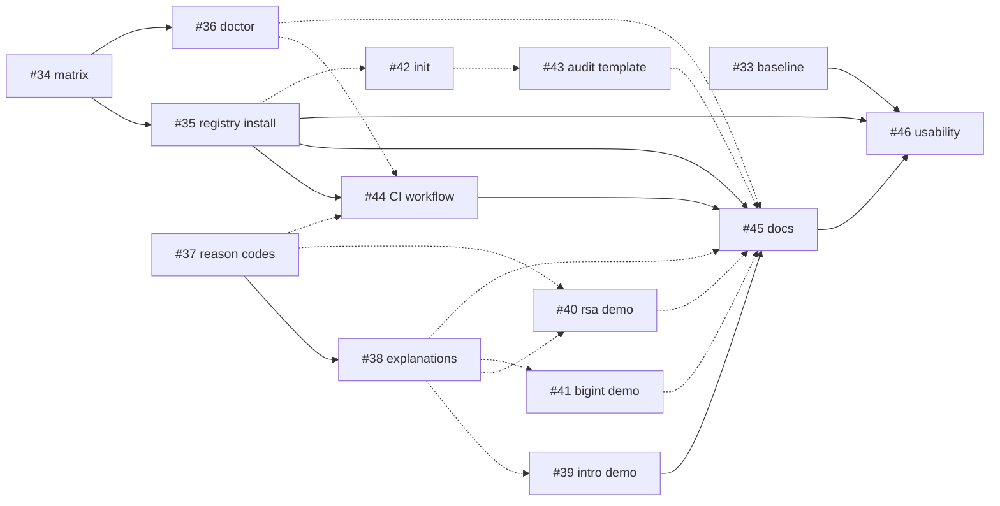

# Milestone 12 — Adoption, Usability, and Real-World Validation

**Status:** Planned. No package implemented.
**GitHub milestone:** [M12](https://github.com/mfaulk/trace-check/milestone/1), issues #33–#46; backlog #47–#49
**Prerequisite:** Milestone 11 and the release preparation (#31, #32), merged
**Primary platform:** Linux x86-64, the pinned Rust toolchain, Valgrind from the distribution

---

## 1. Summary

M1–M11 built the analysis, and M9 and M11 pointed it at unmodified RustCrypto and
`rsa` code. M12 adds no new analysis. It asks two questions:

> Can a Rust developer unfamiliar with trace-check install it, analyze real
> cryptographic code, interpret the results, and put it in CI without help?

> Can trace-check show security value on independently maintained code in a way
> a reader can reproduce?

The work comes in five priorities: installation and first run, results a
newcomer can act on, two reproducible real-world demonstrations, a copyable CI
workflow, and an independent usability check. The measure of success is
whether people outside the project can use the tool, not how many features it
gains.

## 2. Evidence from earlier milestones

* **The analysis works on real code.** M9 detected three planted regressions in
  `crypto-bigint` 0.7.10, covering two branch classes and one address class,
  with the adapter and contract unchanged (`ci/mutate-m9.py`, the `mutate` CI
  job). M11 detected secret-exponent-dependent behaviour in `rsa` 0.9.10's
  `modpow`, which is the arithmetic RUSTSEC-2023-0071 concerns
  (`examples/rsa-control`).
* **Every adopter so far has been the author.** M9's adoption report found
  integration difficulty low, but hazards such as folded adapter symbols, the
  lossy output sink and the leak-site attribution were "silent when wrong"
  (`docs/audits/crypto-bigint/adoption.md`). M11 ranked tool changes by the
  friction it met (`docs/audits/adoption.md` §5).
* **Release preparation is done, publication is not.** #32 added
  `ci/verify-release.py`: a dry-run publish, archive checks, and an
  install-from-archive smoke test in a separate consumer. All five crate names
  return 404 from crates.io (checked 2026-11-14).

## 3. Current capabilities and adoption barriers

### 3.1 What exists (verified against `crates/cargo-trace-check/src/main.rs`)

| Command / flag | What it does today |
|---|---|
| `test [--filter] [--format json]` | Builds and runs hand-written `#[ct_test]`s under Memcheck |
| `check --contract X` / `--all-configured` / `--all-contracts` | Generates inputs for declared contracts and runs them under Memcheck. `--all-contracts` uses the compiler-derived inventory |
| `check --ci` | Fails unless every configured contract was checked |
| `check --explore` | Coverage-guided input search. Needs `llvm-tools` |
| `check --reproducer-dir D` / `--replay F` | Writes or replays a per-finding reproducer |
| `check --artifact-dir D`, `--jobs N` | Keeps the harnesses and executables; runs jobs concurrently with deterministic output |
| `verify --contract X` / `--all-contracts` | Bounded relational symbolic verification (BINSEC image pinned by digest; podman or docker) |
| `coverage` | Read-only matrix of required analyses for each contract |
| `list [--contracts]` | Test metadata, or the compiler-derived contract inventory |
| `doctor`, `init` | **Do not exist** |

Outcomes are typed (`LEAK_DETECTED`, `NO_LEAK_OBSERVED`, `VERIFIED_BOUNDED`,
`INCONCLUSIVE`). Exit codes separate a leak from an incomplete run. Reports
carry provenance. The reasons for an inconclusive or blocked result are
free text (`blocking_reasons: Vec<String>` in `check_report.rs`).

### 3.2 Barriers found during planning

**Verified:**

1. **Nothing is installable from a registry.** The README quick start is to clone,
   build the workspace, run the workspace test suite, then `cargo install
   --path`.
2. **The Valgrind requirement is stated three different ways.** Six files
   (README, technical reference, publishing guide, three crate READMEs) say
   3.28.0 or newer. CI passes on Ubuntu 24.04's **3.22.0** (run
   43542167449). The code accepts any `3.` prefix (`native.rs:34`). → #34
3. **The CLI fails on first use with an unexplained raw error.** A CLI binary
   built from another checkout location failed like this:
   `no matching package named 'trace-check-test' found / location searched:
   crates.io index`. The generated harness resolves its support crate from
   `TRACE_CHECK_TEST_PATH`, then from a path compiled into the CLI, then from
   the registry. Before publication, or after the checkout moves, the last
   fallback fails and gives no hint about the cause or the
   `TRACE_CHECK_TEST_PATH` override. → #35
4. **Missing Valgrind headers are reported late.** `trace-check-secret/build.rs`
   searches `VALGRIND_INCLUDE`, pkg-config, the prefix of the `valgrind` on
   `PATH`, then `/usr/include`. If all of these fail it builds an inert shim and
   emits only a Cargo warning, which Cargo hides for registry packages. The
   backend then refuses the result, so it fails closed, but only after a full
   build. On this machine the `PATH`-prefix rule found headers under
   `~/.local/share/valgrind-3.28.0`. → #36
5. **A fixture report reads as a contradiction.**
   `crypto::tag::verify_tag_volatile_early_exit` prints `LEAK_DETECTED`, then
   `Leaks detected: 0` and `Result: PASS`. That is correct for a fixture whose
   declared expectation is a leak, but a newcomer cannot tell. → #38
6. **`site` names the contract's frame, not the frame that leaked.** This was
   known in M9 and is still the case. It matters most for findings in upstream
   code. → #38
7. **The RSA CI check is weak.** It is `grep -q "LEAK_DETECTED"` on the text
   report, which would also pass for a leak in the adapter or the harness. → #40
8. **The naive early-exit tag comparison compiles branchless at opt-level 3.**
   This is why the M10 fixture had to be replaced. A naive introductory demo
   would therefore show nothing. → #39

**Hypotheses, to be measured in #33:** first-run time is dominated by Cargo
compiling the generated harness and the library, not by Memcheck; and
`rust-version = "1.97"` turns away a meaningful share of consumers.

Planning observations (warm sccache, 64 cores; **not a baseline**):
`cargo build --release -p cargo-trace-check` took 66 s, and one `check` on the
tag fixture took 11–15 s with about 300 MB peak RSS.

## 4. Objective and non-goals

**Objective.** Make trace-check easy to install, configure and use in real Rust
projects, and show its value through reproducible detection of known defects
and planted regressions in independently maintained cryptographic code.

**Non-goals.** No new observation classes or leakage models (no latency or
cache models). No new symbolic algorithms and no symbolic-scalability work. No
AArch64 or macOS support. No general fuzzing infrastructure. No dashboard or
web UI. No vulnerability-discovery campaign. No refactors unrelated to
adoption. No publication or tag without separate maintainer authorization.

## 5. User journeys

| ID | User | Journey | Issues |
|---|---|---|---|
| J1 | Library author | Install the tool, run `doctor`, annotate a function, run `check`, read the result | #35 #36 #42 #38 #39 |
| J2 | Library author | Add trace-check to CI, have a new leaking annotation fail the build, download and replay the reproducer | #44 #38 |
| J3 | Auditor | Analyze an unmodified upstream crate through an adapter with controls | #43 |
| J4 | Evaluator | Reproduce the RSA advisory detection and the crypto-bigint regressions from the published docs | #40 #41 |
| J5 | Anyone | Read an `INCONCLUSIVE` result and know what to do next | #37 #38 |

## 6. Workstreams

| Package | Issue | Pri | Size | One-line outcome |
|---|---|---|---|---|
| M12.0 Baseline | #33 | P0 | M | Rerunnable onboarding protocol and first measurement, committed before any change it measures |
| M12.1 Support matrix | #34 | P0 | S–M | One CI-tested Valgrind/Rust/distro matrix, enforced in code |
| M12.1 Registry install | #35 | P0 | M | Clear failure when the support crate can't be resolved; post-publish smoke test; release checklist |
| M12.2 `doctor` | #36 | P0 | M | Preflight with a real detection self-test |
| M12.3 `init` | #42 | P1 | M | Mechanical setup only. Never infers secrets |
| M12.3 Audit template | #43 | P1 | M | Copyable, CI-instantiated adapter template (decision D3) |
| M12.4 Reason codes | #37 | P0 | L | A stable code on every inconclusive or blocked result |
| M12.4 Explanations | #38 | P0 | M | Leaking frame, why it matters, next step, a replay command |
| M12.5 Intro demo | #39 | P0 | S–M | Secure vs insecure tag comparison on the installed tool, guarded against branch erasure |
| M12.6 RSA demo | #40 | P0 | M | RUSTSEC-2023-0071 detection, packaged and asserted by frame |
| M12.7 crypto-bigint demo | #41 | P1 | M | Clean vs branch vs address regression table (decision D4) |
| M12.8 CI workflow | #44 | P0 | M | Copyable workflow, validated on an external consumer |
| M12.10 Docs | #45 | P0 | M | Linear guide; every introductory command run in CI |
| M12.9 Usability | #46 | P1 (fresh-environment run: P0) | M | Fresh-environment run plus at least two external developers, compared to the baseline |

Each issue has its own implementation guidance, scope, acceptance checklist,
validation commands and evidence requirements. This document does not repeat
them. It sets what must be true of the milestone as a whole.

## 7. Package notes

### 7.1 M12.0 — baseline (#33)
The protocol lives in `ci/adoption/` and results in `docs/adoption/`. The
consumer fixture has no path into the checkout, and a script asserts this. Both
install paths are measured: the checkout path as documented today, and the
archive path as a stand-in for a registry install. **The baseline must be
committed before #35–#45 merge user-facing changes.** Reruns append to it and
never overwrite.

### 7.2 M12.1 — installation (#34, #35)
#34 sets the floors: run the native suite on Valgrind 3.22 (Ubuntu apt), 3.28
(source) and 3.19 (Debian 12, as a probe), replace the prefix check with a real
minimum, and record the Rust-floor decision (D1). #35 wraps the
support-crate resolution failure in a diagnostic, records the resolution path
in provenance, adds a `workflow_dispatch` post-publish smoke job, and writes
the release checklist into `docs/publishing.md`. **Publishing is a separate
maintainer action**, recorded on #35 (D2).

### 7.3 M12.2 — `doctor` (#36)
Required checks: platform, Rust floor, Valgrind version range, header discovery
using the same search order as `build.rs`, a C compiler, and a **self-test**.
The self-test builds a tiny harness with one planted branch and one control,
and passes only if the leak is detected, the control is clean, and calibration
and binding are confirmed. Optional checks: `llvm-tools`, a container runtime,
and the pinned analyzer image. The command exits non-zero only when a required
check fails. Decision D6 decides how the self-test is built.

### 7.4 M12.3 — project setup (#42, #43)
For workflow A (#42), `init` edits `Cargo.toml` with `toml_edit`, writes an
empty `trace-check.toml`, and **prints** the annotation for the user to paste.
It never writes a secret designation. For workflow B (#43), the template comes
first: a pinned upstream crate, an adapter calling the real operation, an
output-sink fold with a full-width test, a planted positive control, a negative
control, an oracle skeleton, and a `compile_error!` gate that blocks use until
the secret boundary is stated. A generator is built only if D3 finds the
template needs more than about five mechanical edits.

### 7.5 M12.4 — reporting (#37, #38)
Every finding or inconclusive result must answer: (1) what was checked, (2) what
was detected, (3) where, meaning the leaking frame and the contract frame, each
labelled as contract, library, dependency, harness or std, (4) why it matters,
(5) the evidence: class, origin, isolated case, controls, (6) the limits:
observation model, artifact, input domain, (7) the next step, and (8) how to
reproduce it, as an exact `--replay` command.

Reason codes are a closed enum documented in `docs/reason-codes.md`, and
`other` is not allowed. Outcomes, exit codes and deterministic output stay
unchanged; the only JSON changes are additions, behind a schema-version bump.
SARIF is deferred (#49).

### 7.6 M12.5 — intro demo (#39)
`examples/first-check/` is a standalone crate, not a workspace member. The
insecure comparison uses the `read_volatile` early exit; the secure one uses
`subtle`. A disassembly guard fails CI if the insecure branch is optimized
away. It runs on the archive-installed CLI in `.github/workflows/demos.yml`.

### 7.7 M12.6 — RSA (#40)
The JSON assertion requires the finding's leaking frame to be in
`num-bigint-dig` or `rsa` source, and confirms the operation is present in the
analyzed artifact. The base-secret control must stay `INCONCLUSIVE`, with the
`provenance-unresolved` code. The demo page carries a claim-limits section: it
does not reproduce the Marvin timing oracle and does not recover keys.

### 7.8 M12.7 — crypto-bigint (#41)
`mutate-m9.py --demo` runs the clean version and mutations B and C with
identical harness and config hashes, includes a disassembly diff and checks
the oracle. Decision D4 settles how to show that a path-only check misses C.

### 7.9 M12.8 — CI (#44)
`docs/ci/trace-check.yml` is the copyable workflow. It installs a pinned
version, runs `doctor`, then
`check --all-contracts --ci --format json --reproducer-dir`, and on failure
emits `::error` annotations and uploads artifacts. It is validated on three
variants of the consumer: clean, leaking, and incomplete (D5).

## 8. Priorities

* **P0 (baseline success needs all of these):** #33 #34 #35 #36 #37 #38 #39 #40 #44 #45,
  and the fresh-environment run in #46.
* **P1:** #41 #42 #43, and the external-participant study in #46.
* **P2 / backlog (outside the milestone):** #47 SHAKE provenance, #48 analyzer
  log, #49 SARIF.

If the schedule slips, drop in this order: the #43 generator (keep the
template), #42, the #41 path-only comparison (keep the table), then #49
entirely. Never drop #39, #40, #44 or #45.

## 9. Design decisions with gates

| ID | Question | Issue | Gate / default |
|---|---|---|---|
| D1 | Valgrind floor, and whether Rust 1.97 is justified | #34 | Floor = oldest version that passes the full native suite. Keep the Rust floor only if a named feature needs it |
| D2 | When to publish 0.1.0 | #35 | After #34 and #35's diagnostics merge. Needs explicit maintainer authorization. Demos develop against the archive install until then |
| D3 | Audit generator, or template only | #43 | Template only, unless it needs more than about 5 mechanical edits (2-day time-box) |
| D4 | How to show that path-only checking misses mutation C | #41 | Default: report "0 branch findings, ≥1 address finding" and cite M2. Use a live path comparison only if it works within 1 day |
| D5 | Annotations: a `--format github` flag or an external script | #44 | The flag, if it's under 100 lines |
| D6 | `doctor` self-test: build on the fly, or ship a precompiled probe | #36 | Build on the fly with the real resolution path, since that tests what users hit. Budget: under 60 s cold |

Decisions are recorded in this table when they are made, with the evidence
behind them.

## 10. Baseline measurements and experiments

All measurements use the #33 protocol: Ubuntu 24.04 and Fedora containers, no
trace-check source baked into the image, steps taken verbatim from the docs,
`/usr/bin/time` for wall-clock and RSS, and errors captured verbatim.

| Experiment | When | Issue |
|---|---|---|
| E1: onboarding baseline, both install paths | Before Phase B merges | #33 |
| E2: Valgrind 3.19 / 3.22 / 3.28 fixture equivalence | Phase A | #34 |
| E3: post-publish install from an empty `CARGO_HOME` | After D2 | #35 |
| E4: `doctor` with headers hidden, Valgrind absent, and Valgrind below the floor | Phase B | #36 |
| E5: JSON before and after reason codes on every CI fixture (only additions allowed) | Phase B | #37 |
| E6: clean / leaking / incomplete external consumer CI runs | Phase B | #44 |
| E7: fresh-environment run, then external participants | Phase C | #46 |

## 11. Scoreboard

| Metric | Baseline (2026-11-14) | Target | Measured by | Evidence |
|---|---|---|---|---|
| Registry installation | Impossible: 0 of 5 crates published | Install from crates.io succeeds in clean Ubuntu 24.04 and Fedora containers | E3 smoke job | Job log on #35 |
| Time to first check | Not measured. Checkout path needs a full workspace build and test | < 10 min on a prepared machine, excluding toolchain download | #33 protocol | `docs/adoption/*.json` |
| Manual steps to first check | Not measured | ≤ 5 commands after the prerequisites | #33 script count | same |
| Prerequisite diagnosis | Discovered mid-run or after a build | `doctor` identifies each forced fault in E4 | E4 | CI log |
| Third-party demonstrations reproducible from public docs | 0 packaged (controls exist inside the workspace) | 2 (rsa, crypto-bigint) | `demos.yml` | CI log |
| Known-defect detection | rsa exponent and M9 mutations A/B/C detected | Every predeclared positive control detected, at the right frame | #40 #41 assertions | CI log |
| Negative controls | Clean crypto-bigint and `verify_tag` give `NO_LEAK_OBSERVED` | 0 false positives on the declared negative controls | #39 #41 #43 | CI log |
| Inconclusive results with a reason code | 0% (free text) | 100% of inventoried sites | #37 test | Test output |
| CI coverage | `--all-contracts --ci` exists; no consumer workflow | External consumer: new leaking annotation fails CI with no config change | E6 | CI log |
| Documented commands executed in CI | 0 | 100% of `sh tested` blocks in README and `docs/guide/` | `ci/verify-docs.py` | CI log |
| Independent usability | 0 studies | Fresh-environment run (baseline success); ≥ 2 unfamiliar developers end to end with no maintainer intervention (strong success) | #46 | `docs/adoption/usability-*.md` |

The targets are proposals until E1 lands. #33 may adjust a target, with the
reason recorded, but never after seeing an implementation's result.

**Success levels.**
* **Baseline:** all P0 issues done; the tool installs from crates.io; the first
  run works; findings are understandable; the intro and RSA demos are
  reproducible in CI; the fresh-environment run is recorded.
* **Strong:** the above, plus #41, the external consumer adopts the CI workflow,
  and at least two independent developers succeed.
* **Stretch:** an upstream maintainer adopts trace-check in their CI, or an
  independently confirmed and previously unknown defect is found and disclosed
  through the process in §13.

## 12. Acceptance and failure criteria

A package is **complete** when every box on its issue is ticked, its evidence
is attached, and its validation commands pass in CI. A command exiting 0 is
never enough by itself: each check asserts outcome, class and frame.

The milestone **fails** if any of these happens, whatever else is done:

* A required analysis that is incomplete, unsupported or inconclusive lets an
  enforced CI run pass.
* A dynamic `NO_LEAK_OBSERVED` is presented anywhere as proof, or
  `VERIFIED_BOUNDED` is presented outside its domain and artifact.
* A demonstration claims more than its evidence supports, such as the RSA demo
  implying key recovery.
* A finding in upstream code is attributed to the adapter or the harness, or the
  reverse, in published material.
* A tool-generated file designates a parameter as secret.
* A usability result is reported for participants who did not take part.

## 13. Evidence standards for demonstrations

Each demonstration (#39 #40 #41, and #43's instantiation) must:

1. Pin every upstream dependency exactly, with a committed `Cargo.lock`.
2. Use the installed CLI, not `cargo run -p` from the workspace.
3. Assert outcome, finding class and leaking frame from JSON, never by grepping
   text.
4. Prove the analyzed artifact contains the operation (symbol or disassembly).
5. Include a positive and a negative control, and confirm calibration and
   secret binding.
6. Keep upstream defects (rsa) separate from planted mutations (crypto-bigint)
   and from analyzer fixtures (`examples/first-check`) in every page title and
   summary.
7. Generate output excerpts by script, never by hand.
8. State the claim boundary: observation classes, artifact, toolchain, and input
   domain.

Any candidate *new* vulnerability found during M12 is out of scope as work. It
is handled by private, independent confirmation first, then coordinated
disclosure to the maintainers through their security policy. Nothing is
published before that coordination, and no public issue is filed in this
repository until disclosure.

## 14. Dependency graph and parallel plan

Solid arrows are hard dependencies. Dashed arrows are soft: start against the
current behaviour and refresh once the prerequisite merges.

**Critical path:** #34 → #35 (plus D2, publication) → #44 → #45 → #46. #33 must
finish before Phase B changes merge.

**Phase A — establish the baseline and unblock first use:** #33, #34, #37,
#39, #40.

**Phase B — usability and demonstrations, in parallel:** #35, #36, #38, #41,
#42, #43, #44.

**Phase C — integrate and validate:** #45, #46, and publication if not already
done.

**Agent lanes and conflict boundaries:**

| Lane | Issues | Files it owns | Shared-file rule |
|---|---|---|---|
| 1 Install | #34 → #35 | `native.rs` version check, `dynamic_harness.rs` resolution, `docs/publishing.md`, `ci/verify-release.py` | — |
| 2 Preflight / setup | #36, #42, #43 | new `doctor.rs` and `init.rs`, `examples/audit-template/` | `main.rs`: add only the enum variant and dispatch. Second to merge rebases |
| 3 Reporting | #37 → #38 | `check_report.rs`, `library_report.rs`, `cargo-trace-check/src/report.rs`, `docs/reason-codes.md` | Sequential inside the lane; nobody else edits these files |
| 4 Demos | #39, #40, #41 | `examples/first-check/`, `docs/demos/`, `ci/demos/`, `ci/mutate-m9.py` | New jobs go in `.github/workflows/demos.yml`, never `ci.yml` |
| 5 CI and docs | #44 → #45 | `docs/ci/`, `docs/guide/`, `README.md`, `ci/verify-docs.py` | The only lane that edits `README.md` |
| 6 Measurement | #33 → #46 | `ci/adoption/`, `docs/adoption/` | — |

Stable seams to build against while a prerequisite is in flight: the
**archive install** from `verify-release.py` stands in for crates.io (#35);
the **current JSON stack array** stands in for `leak_frame` (#38); **prose
reasons** stand in for codes (#37), and assertions add the codes once they
land.

## 15. Risks and contingencies

| Risk | Likelihood | Impact | Contingency |
|---|---|---|---|
| Publication authorization is delayed | Medium | Blocks the registry metric and the final form of #44 and #45 | Ship everything on the archive install; the scoreboard records registry installation as unmet |
| A future toolchain erases the demo branch | Medium | The intro demo would silently pass | #39's disassembly guard fails CI. Fix the demo; never relax the guard |
| Valgrind 3.22 and 3.28 disagree on a fixture | Low | Support floor too high | Floor = 3.28; document the distro gap; `doctor` gives the source-install command |
| Frame classification is unreliable when code is inlined | Medium | `leak_frame` wrong for upstream code | Fall back to listing every non-harness frame and label `ambiguous` (code `attribution-ambiguous`) rather than guess |
| No external participants are available | Medium | Strong success not reached | Record the fresh-environment run; leave strong success open; do not substitute maintainers |
| `doctor` self-test is too slow cold | Medium | A preflight nobody runs | D6 alternative: cache the probe build under `CARGO_HOME`; keep the real resolution path |
| Reason-code inventory turns out larger than expected | Medium | #37 grows | Split by subcommand (`check` first); each slice still has no `other` |
| A `rust-version` floor of 1.97 excludes users | Unknown | Adoption | Decide under D1; the macro crate's 1.88 CI job is the pattern to follow |

## 16. Release and documentation requirements

* 0.1.0 is published only after #34 and #35 merge and the maintainer authorizes
  it on #35. Order and checklist are in `docs/publishing.md`. Tag after the
  post-publish smoke test passes.
* `CHANGELOG.md` gets one entry per user-visible change: `doctor`, `init`,
  reason codes (with schema bumps), explanations, and the corrected
  prerequisites.
* README and `docs/guide/` contain only commands executed by
  `ci/verify-docs.py`. Checkout-only material moves to `CONTRIBUTING.md`.
* Every version requirement points to the single matrix table from #34.
* Milestone docs M1–M11 are historical and are not rewritten. Their unticked
  checklists stay as they are.

## 17. Definition of done

- [ ] Every P0 issue closed, with its evidence attached.
- [ ] Scoreboard filled with measured values (not targets) and links to evidence.
- [ ] `demos.yml` green: intro, RSA, external-consumer CI; crypto-bigint if #41 is done.
- [ ] `cargo trace-check doctor` passes on the CI runner and fails correctly under each E4 fault.
- [ ] Every `INCONCLUSIVE` or blocked result on every CI fixture carries an asserted reason code.
- [ ] A finding's `reproduce:` command reproduces it, asserted in CI.
- [ ] Every `sh tested` documentation block runs in CI.
- [ ] Fresh-environment usability run recorded against the baseline.
- [ ] D1–D6 recorded in §9 with their evidence.
- [ ] No §12 failure criterion triggered.
- [ ] 0.1.0 published, or the absence of authorization recorded as the one open baseline item.

## 18. Linked issues

| # | Title | Pri |
|---|---|---|
| [#33](https://github.com/mfaulk/trace-check/issues/33) | M12.0: Measure clean-environment onboarding against a fixed baseline protocol | P0 |
| [#34](https://github.com/mfaulk/trace-check/issues/34) | M12.1: Resolve the Valgrind 3.28 vs 3.22 discrepancy and declare a tested support matrix | P0 |
| [#35](https://github.com/mfaulk/trace-check/issues/35) | M12.1: Make the registry install path fail clearly and validate it end to end | P0 |
| [#36](https://github.com/mfaulk/trace-check/issues/36) | M12.2: Add `cargo trace-check doctor` with a real detection self-test | P0 |
| [#37](https://github.com/mfaulk/trace-check/issues/37) | M12.4: Give every INCONCLUSIVE and blocking result a stable reason code | P0 |
| [#38](https://github.com/mfaulk/trace-check/issues/38) | M12.4: Make findings self-explaining: leaking frame, why it matters, how to reproduce | P0 |
| [#39](https://github.com/mfaulk/trace-check/issues/39) | M12.5: Ship a secure-vs-insecure tag comparison demo that runs on the installed tool | P0 |
| [#40](https://github.com/mfaulk/trace-check/issues/40) | M12.6: Package the RUSTSEC-2023-0071 rsa detection as a reproducible demonstration | P0 |
| [#41](https://github.com/mfaulk/trace-check/issues/41) | M12.7: Package the crypto-bigint branch and address regressions as a reader-facing demonstration | P1 |
| [#42](https://github.com/mfaulk/trace-check/issues/42) | M12.3: Add `cargo trace-check init` for annotating a first-party library | P1 |
| [#43](https://github.com/mfaulk/trace-check/issues/43) | M12.3: Provide a validated template for auditing an unmodified external library | P1 |
| [#44](https://github.com/mfaulk/trace-check/issues/44) | M12.8: Publish a copyable GitHub Actions workflow and validate it on an external consumer | P0 |
| [#45](https://github.com/mfaulk/trace-check/issues/45) | M12.10: Restructure user docs into a tested path from install to external audit | P0 |
| [#46](https://github.com/mfaulk/trace-check/issues/46) | M12.9: Run a fresh-environment and an independent-developer usability validation | P1 / P0 part |

## 19. Deferred work

* [#47](https://github.com/mfaulk/trace-check/issues/47) SHAKE XOF provenance
  loss: ML-DSA signing is not analyzable. Ranked first by M11, but no M12
  demonstration depends on it.
* [#48](https://github.com/mfaulk/trace-check/issues/48) Keep the BINSEC log
  for `unknown` results. Symbolic diagnostics; the M12 demos are dynamic.
* [#49](https://github.com/mfaulk/trace-check/issues/49) SARIF. Annotations
  cover the first need.
* Not filed, because there is no concrete trigger yet: declaring public regions
  of a secret parameter (M11 §3.4), a `no_std` `trace-check-secret` (M11 §3.5),
  comparison feedback for exact equalities and per-parameter mutation
  weighting (M9 adoption report, ranks 4 and 3), a persistent evidence cache, separate `--jobs` limits for
  each phase, AArch64, latency models, prebuilt binaries and distro packages.
  File them when an adopter hits one.
